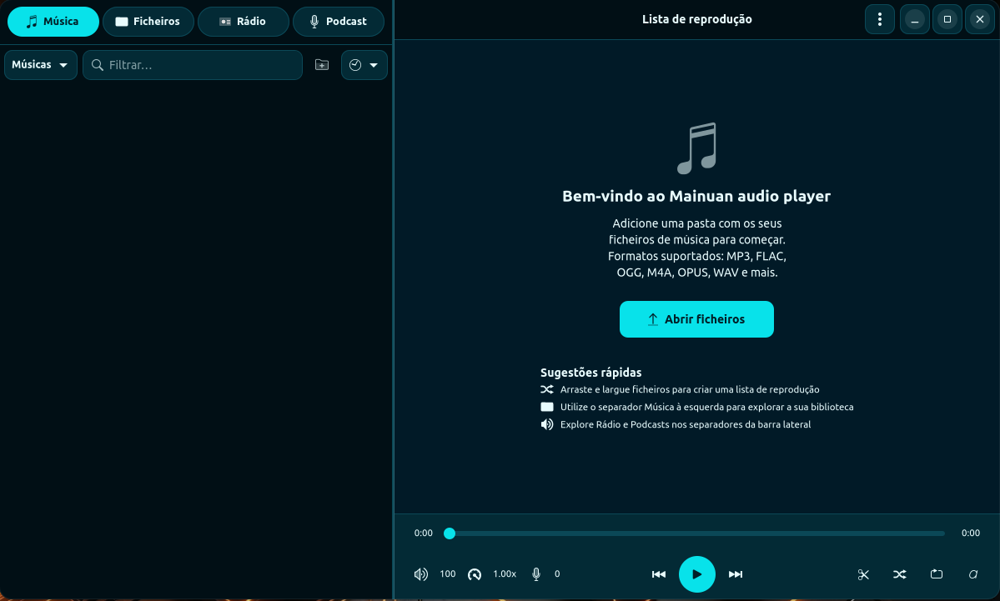
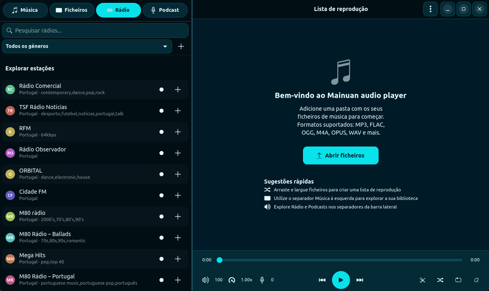
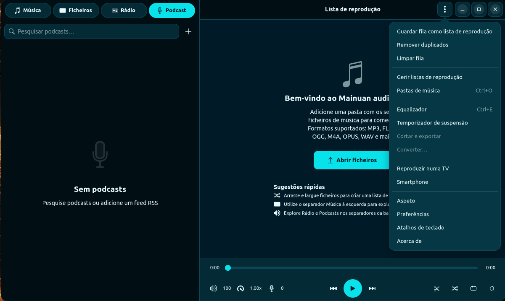

<div align="center">


# MAINUAN AUDIO PLAYER


Leitor de música e áudio para a distribuição Mainuan, em **GTK4/libadwaita** com **mpv**. Mantém uma biblioteca de músicas com playlists e fila de reprodução, toca rádios online e podcasts, mostra letras e tem controlos MPRIS para as teclas multimédia.

</div>

## 📸 Screenshots

<div align="center">
  
  
  
</div>

## ✨ Funcionalidades

- **Formatos:** MP3, FLAC, OGG Vorbis, Opus, AAC e WAV.
- **Biblioteca de músicas:** pastas monitorizadas, organização por artista, álbum e género, edição de metadados e classificações.
- **Playlists e fila de reprodução:** criar playlists, guardar a fila como playlist, remover duplicados e importar/exportar listas (`.m3u`, `.m3u8`, `.pls`).
- **Rádio online e podcasts:** pesquisa de estações e de podcasts, com subscrições.
- **Letras:** painel de letras das músicas.
- **Equalizador e temporizador de sono.**
- **Cortar e exportar** excertos de áudio, e **converter** ficheiros.
- **MPRIS:** controlo pelas teclas multimédia e pelo ambiente de trabalho.
- **Visual Mainuan:** cores, formas e tipo de letra da Mainuan store.
- **Multilingue:** mais de 30 idiomas, incluindo português (PT) e português (BR).

## 📋 Requisitos

- Linux **amd64** com GTK 4.22 ou superior e libadwaita 1.9 ou superior
- `mpv`, `libmpv2` e `ffmpeg`
- PulseAudio ou PipeWire (compatível com PulseAudio)

As dependências são instaladas automaticamente pelo `apt` ao instalar o `.deb`.

## 📦 Instalação

Descarrega o ficheiro `.deb` mais recente na página de [Releases](../../releases) e instala:

```bash
sudo apt install ./mainuan-audio-player_1.0.1.deb
```

Depois abre **Mainuan audio player** no menu de aplicações, ou executa no terminal:

```bash
mainuan-audio-player
```

O pacote substitui o `big-audio-player` (declara `Conflicts` e `Replaces`).

## 🔧 Compilar o pacote a partir do código

```bash
git clone https://github.com/mainuan/mainuan-audio-player.git
cd mainuan-audio-player
dpkg-deb --root-owner-group --build package mainuan-audio-player_1.0.1.deb
```

## 📁 Estrutura do projeto

```text
mainuan-audio-player/
├── package/
│   ├── DEBIAN/                          # control, md5sums, postinst, postrm
│   └── usr/
│       ├── bin/                         # lançador (mainuan-audio-player)
│       ├── lib/mainuan-audio-player/    # executável e biblioteca de marca
│       └── share/                       # .desktop, metainfo, ícones, copyright
├── assets/screenshots/
├── CHANGELOG.md
├── LICENSE
└── README.md
```

## 🆕 Lançamento da versão 1.0.1

Publicação do projeto. Vê o [CHANGELOG](CHANGELOG.md) para o histórico completo.

## 🙏 Créditos

Versão com a marca Mainuan do leitor de áudio **big-audio-player**, trabalho original da **BigLinux** ([big-multimedia](https://github.com/biglinux/big-multimedia)). O aviso de direitos de autor original é mantido, conforme exige a GPL.

## 📄 Licença

Distribuído sob a licença **GPL-3.0 ou posterior**. Vê o ficheiro [LICENSE](LICENSE).

## 👤 Autor

**David Caixinha** — tugatechlabDC (adaptação Mainuan)

## 🤝 Contribuição

Para reportar erros ou pedir funcionalidades, abre um [Issue](https://github.com/mainuan/mainuan-audio-player/issues). Para propor alterações, envia um pull request para o ramo `main` e regista qualquer alteração visível no [CHANGELOG.md](CHANGELOG.md).
